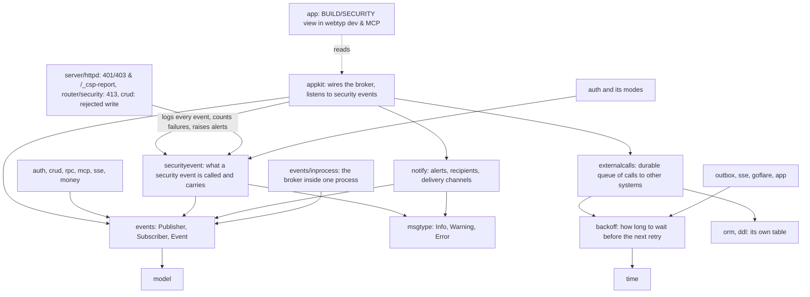

# Events, queues and alerts

Map of the whole framework: [framework-map](../framework-map/SKILL.md). Last link: the code (`go doc webtyp.com/events`).

| Repo | Its one job |
|---|---|
| `events` | the publish/subscribe contract (`Publisher`, `Subscriber`, `Event`); `events/inprocess` is the broker inside one process |
| `securityevent` | the one vocabulary of security events (16 `Kind`s with OWASP names and levels); `Reporter.Report` and `Listen`; never a secret |
| `externalcalls` | a durable queue of calls to other systems: record first, call later, retry with `backoff` |
| `backoff` | how long to wait before the next retry (doubles up to a longest delay); never sleeps |
| `notify` | alerts (`Alert` with a `msgtype` severity), recipients and the channels that deliver them |

## Rules

- A module publishes through `events.Publisher` and listens through `events.Subscriber`; it never imports a concrete broker.
- Anything suspicious is reported with `securityevent` (`Reporter.Report`), never as a printed line or a local event type.
- A call to another system goes through `externalcalls` (record, then call), never straight from a rule.
- A retry delay comes from `backoff`, never a hand-written loop.

## Open defects (each leaves when fixed)

- `notify`: `appkit` raises security alerts on it and persists `Warning`/`Error` alerts to `logs.log` (`!wasm`, 7d / 1 MiB via `notify.NewCriticalFileLog`); external delivery (email/WhatsApp) is wired by the app on `notify.TopicAlert`.
