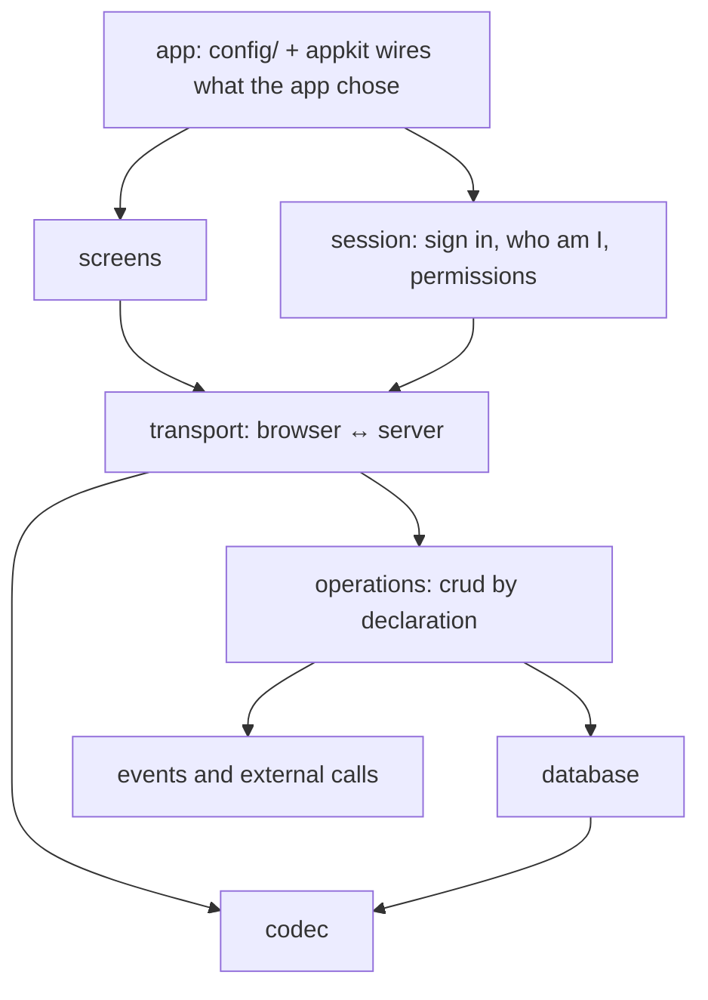

# Framework map — zoom from the app down to the code

Three levels, like a map: **this index** (which components exist) → **the component's skill** (which repo does what,
in which order they depend) → **the repo's code** (`go doc <pkg> <Symbol>`, the source). The code is the last link
because it never goes stale; a README that contradicts the code is a defect of that repo, fixed there.

| Component | Repos | Skill |
|---|---|---|
| app | `appkit`, each app's `config/` | **project-layout**, **app-modules**, **module-layout**, **app-server-main** |
| screens | `view`, `layout`, `form`, `components`, `dom`, `widget` | **dom-elements**, **components**, **form-codegen**, **widget-styling**, **ui-consistency** |
| session | `auth`, `rbac`, `access`, `user` | none yet: read the code |
| transport | `router`, `rpc`, `mcp`, `server`, `fetch`, `sse` | **api-harness** rules 10–11; component skill none yet |
| operations | `crud`, `model`, `definitionc` | **form-codegen** (definitions), **crud-module-migration** |
| database | `orm`, `ddl`, `storage`, `sqlt`, `sqlite`, `postgres`, `indexdb`, `dbsync` | **isomorphic-libraries**; component skill none yet |
| codec | `json` | **wasm** (stdlib replacement); component skill none yet |
| events | `events`, `outbox`, `externalcalls` | none yet: read the code |
| texts | `lang` | **translations**, **langc** |
| build and dev | `sitec`, `app`, `devflow` | **wasm**, **webtyp-app** |
| deploy | `goflare`, `cloudflare`, `server` | **app-rest-edge**, **secrets** |

## Rules

- **Each piece belongs to one component and does one thing.** Before writing code, find the component here and the repo
  that owns the concern in its skill (or its code). Code that belongs to another component goes to that repo.
- **`appkit` wires, it implements nothing.** It is the one place an app configures; each choice is a value of the
  owning piece's interface (a sign-in mode is an `auth.Authenticator`), never an enum or a switch inside `appkit`.
- **Arrows point to what a piece may import.** A lower piece never imports a higher one; a missing contract at a
  boundary is a defect upstream (**api-design** gate 4).
- **A skill holds what changes rarely** (pieces, responsibilities, dependency order); signatures, fields and errors live
  only in the code. A component without a skill is read from its code, and its skill is written when it is next touched.
- A new, split or removed repo updates this table and its component's skill in the same turn (**devskills**).
