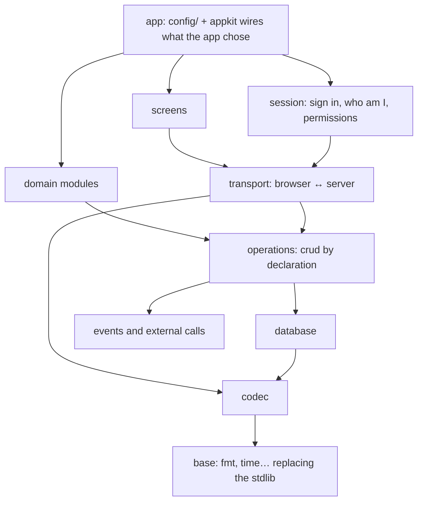

# Framework map — zoom from the app down to the code

Three levels, like a map: **this index** (which components exist) → **the component's skill** (which repo does what,
in which order they depend) → **the repo's code** (`go doc <pkg> <Symbol>`, the source). The code is the last link
because it never goes stale; a README that contradicts the code is a defect of that repo, fixed there.

Side components (files, documents, browser platform, AI, domain values) are imported by the pieces that need them;
build, dev and deploy are tools around the app, never imported by it — except `devtools`, the development screens
an app's browser main hands to its layout.

| Component | Repos | Skill |
|---|---|---|
| app | `appkit`, each app's `config/` | **project-layout**, **app-server-main** |
| domain modules | `veltylabs/modules/*` | **app-modules**, **module-layout** |
| screens | `view`, `layout`, `form`, `input`, `components`, `widget`, `dom`, `html`, `css`, `svg`, `icons`, `avatar`, `erd` | **dom-elements**, **components**, **form-codegen**, **widget-styling**, **ui-consistency**, **ui-icons** |
| session | `auth`, `rbac`, `access`, `user`, `webauthn`, `jwt` | none yet: read the code |
| transport | `router`, `rpc`, `mcp`, `server`, `fetch`, `sse`, `broker`, `idempotency` | **api-harness** rules 10–11; component skill none yet |
| operations | `crud`, `model`, `definitionc`, `definitioncheck` | **form-codegen**, **crud-module-migration** |
| database | `storage`, `orm`, `ddl`, `migrate`, `sqlt`, `sqlite`, `postgres`, `indexdb`, `dbsync`, `changelog`, `sqlmcp`, `dataimport` | **isomorphic-libraries**; component skill none yet |
| events | `events`, `outbox`, `externalcalls`, `backoff`, `notify` | none yet: read the code |
| codec | `json`, `binary`, `base64`, `escape` | **wasm**; component skill none yet |
| base | `fmt`, `time`, `calendar`, `context`, `filepath`, `crypto`, `unixid`, `msgtype`, `color`, `font`, `country` | **wasm** |
| configuration | `env` (reads `keyring` outside the browser), `keyring`, `dbus` | **secrets** |
| texts | `lang` | **translations**, **langc** |
| files | `files`, `disk`, `opfs`, `filetype`, `image`, `imagemin`, `artifacts` | **ui-images** |
| documents | `pdf`, `chart`, `qr` | none yet: read the code |
| browser platform | `await`, `jsvalue`, `js`, `device`, `media`, `pwa` | **wasm** |
| domain values | `money`, `stock`, `network` | **module-layout** |
| AI and voice | `agent`, `agentcontext`, `agentmemory`, `agentworker`, `agenteval`, `llm`, `qwen`, `lfm`, `decoder`, `encoder`, `tokenizer`, `nn`, `weights`, `weightsc`, `embed`, `bekko`, `vector`, `vectordb`, `retrieval`, `audio`, `phoneme`, `stt`, `tts` | none yet: read the code |
| build and dev | `app`, `appkitc`, `sitec`, `gobuild`, `devflow`, `devtui`, `tui`, `devwatch`, `devbrowser`, `devharness`, `devtools`, `devskills`, `gocheck`, `gorun`, `command`, `modfind`, `depfind`, `git`, `wizard`, `markdown`, `kvdb`, `installer`, `goinstall`, `tinygo`, `wasmbrowsertest`, `screenshot` | **webtyp-app**, **codejob**, **testing** |
| deploy | `deploy`, `goflare`, `cloudflare`, `github`, `ghaction`, `gorelease`, `sitepub`, `selfupdate`, `update` | **app-rest-edge**, **secrets** |
| examples | `goflare-demo`, `website` | — |

## Rules

- **Each piece belongs to one component and does one thing.** Before writing code, find the component here and the repo
  that owns the concern in its skill (or its code). Code that belongs to another component goes to that repo.
- **`appkit` wires, it implements nothing.** It is the one place an app configures; each choice is a value of the
  owning piece's interface (a sign-in mode is an `auth.Authenticator`), never an enum or a switch inside `appkit`.
- **Arrows point to what a piece may import.** A lower piece never imports a higher one; a missing contract at a
  boundary is a defect upstream (**api-design** gate 4).
- **A skill holds what changes rarely** (pieces, responsibilities, dependency order); signatures, fields and errors live
  only in the code. A component without a skill is read from its code, and its skill is written when it is next touched.
- A new, split or removed repo updates this table and its component's skill in the same turn (**devskills**).
