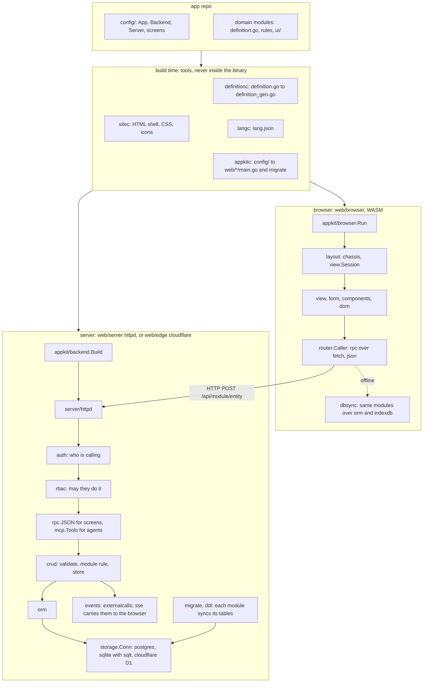

# Framework map — zoom from the app down to the code

Three levels, like a map: **this index** (which components exist) → **the component's skill** (linked in the table) (which repo does what,
in which order they depend) → **the repo's code** (`go doc <pkg> <Symbol>`, the source). The code is the last link
because it never goes stale; a README that contradicts the code is a defect of that repo, fixed there.

The app declares (`config/`, modules); the build tools turn that into code; at run time the same `crud` operation
travels from a screen through `rpc` to `crud` and `orm`. Libraries are isomorphic: the browser runs `orm` too, over
`indexdb` (**isomorphic-libraries**). `codec` (`json`) and `base` (`fmt`, `time`…) sit under every box; side components (files, documents, AI…)
are imported where needed; build, dev and deploy never enter the app, except `devtools` (development screens).

Repos grouped by domain. 🟢 one clear job, in the right domain · 🔴 a defect listed below. Only the
framework (`webtyp`); apps that consume it and their modules are not part of the map. Who imports whom inside and between domains is drawn in each domain's skill, not here.

| Component | Repos | Skill |
|---|---|---|
| base | 🟢 `fmt`, 🟢 `time`, 🟢 `calendar`, 🟢 `context`, 🟢 `filepath`, 🟢 `crypto`, 🟢 `unixid`, 🟢 `msgtype`, 🟢 `color`, 🟢 `font` | [wasm](../wasm/SKILL.md) |
| codec | 🟢 `json`, 🟢 `escape`, 🟢 `base64`, 🔴 `binary` | [wasm](../wasm/SKILL.md) |
| texts | 🔴 `lang` | [translations](../translations/SKILL.md), [langc](../langc/SKILL.md) |
| configuration | 🟢 `env`, 🟢 `keyring`, 🟢 `dbus` | [secrets](../secrets/SKILL.md) |
| model and definitions | 🟢 `model`, 🟢 `input`, 🟢 `definitioncheck`, 🟢 `definitionc` (`input` holds the field kinds of a definition, not screens; `definitionc` is the generator) | [form-codegen](../form-codegen/SKILL.md) |
| operations | 🟢 `crud` | [crud-module-migration](../crud-module-migration/SKILL.md) |
| database | 🟢 `storage`, 🟢 `orm`, 🟢 `ddl`, 🟢 `migrate`, 🟢 `sqlt`, 🟢 `sqlite`, 🟢 `postgres`, 🟢 `indexdb`, 🟢 `changelog`, 🟢 `dataimport` | [isomorphic-libraries](../isomorphic-libraries/SKILL.md) |
| offline sync | 🔴 `dbsync`, 🟢 `outbox` | none yet |
| events | 🟢 `events`, 🟢 `externalcalls`, 🟢 `backoff`, 🟢 `notify`, 🔴 `securityevent` | none yet |
| transport | 🟢 `router`, 🟢 `rpc`, 🟢 `mcp`, 🟢 `fetch`, 🟢 `sse`, 🟢 `idempotency`, 🔴 `server`, 🔴 `broker` | [api-harness](../api-harness/SKILL.md) rules 10–11 |
| sign-in and permissions | 🔴 `auth`, 🟢 `rbac`, 🟢 `access`, 🟢 `user`, 🟢 `webauthn`, 🟢 `jwt` | [sign-in-and-permissions](../sign-in-and-permissions/SKILL.md) |
| screens | 🟢 `view`, 🟢 `form`, 🟢 `components`, 🟢 `widget`, 🟢 `dom`, 🟢 `html`, 🟢 `css`, 🟢 `svg`, 🟢 `icons`, 🟢 `avatar`, 🔴 `layout` | [dom-elements](../dom-elements/SKILL.md), [components](../components/SKILL.md), [widget-styling](../widget-styling/SKILL.md), [ui-consistency](../ui-consistency/SKILL.md), [ui-icons](../ui-icons/SKILL.md) |
| app | 🔴 `appkit`, each app's `config/` | [project-layout](../project-layout/SKILL.md), [app-server-main](../app-server-main/SKILL.md) |
| domain values | 🟢 `money`, 🟢 `stock`, 🟢 `network`, 🟢 `country` | [module-layout](../module-layout/SKILL.md) |
| files and images | 🟢 `files`, 🟢 `disk`, 🟢 `opfs`, 🟢 `filetype`, 🟢 `artifacts`, 🔴 `image`, 🔴 `imagemin` | [ui-images](../ui-images/SKILL.md) |
| documents | 🔴 `pdf`, 🟢 `chart`, 🟢 `qr` | none yet |
| browser platform | 🟢 `await`, 🟢 `jsvalue`, 🟢 `js`, 🟢 `device`, 🟢 `media`, 🔴 `pwa` | [wasm](../wasm/SKILL.md) |
| AI and voice | 🟢 `agent`, 🟢 `agentcontext`, 🟢 `agentmemory`, 🟢 `agentworker`, 🟢 `agenteval`, 🟢 `llm`, 🟢 `qwen`, 🟢 `lfm`, 🟢 `decoder`, 🟢 `encoder`, 🟢 `tokenizer`, 🟢 `nn`, 🟢 `weights`, 🟢 `weightsc`, 🟢 `embed`, 🟢 `bekko`, 🟢 `vector`, 🟢 `vectordb`, 🟢 `audio`, 🟢 `phoneme`, 🟢 `stt`, 🟢 `tts`, 🔴 `retrieval` | none yet |
| build and dev | 🟢 `app`, 🟢 `appkitc`, 🟢 `sitec`, 🟢 `gobuild`, 🟢 `devflow`, 🟢 `devtui`, 🟢 `tui`, 🟢 `devwatch`, 🟢 `devbrowser`, 🟢 `devharness`, 🟢 `devtools`, 🟢 `erd`, 🟢 `sqlmcp`, 🟢 `devskills`, 🟢 `gocheck`, 🟢 `gorun`, 🟢 `command`, 🟢 `modfind`, 🟢 `depfind`, 🟢 `git`, 🟢 `wizard`, 🟢 `markdown`, 🟢 `kvdb`, 🟢 `installer`, 🟢 `goinstall`, 🟢 `tinygo`, 🟢 `wasmbrowsertest`, 🟢 `screenshot` | [webtyp-app](../webtyp-app/SKILL.md), [testing](../testing/SKILL.md) |
| deploy | 🟢 `deploy`, 🟢 `goflare`, 🟢 `cloudflare`, 🟢 `github`, 🟢 `ghaction`, 🟢 `gorelease`, 🟢 `sitepub`, 🟢 `selfupdate`, 🟢 `update` | [app-rest-edge](../app-rest-edge/SKILL.md), [secrets](../secrets/SKILL.md) |
| examples | 🟢 `goflare-demo`, 🟢 `website` | — |

**Why each 🔴** (found in the imports of non-test code; a mark leaves when its repo is fixed):
- `appkit`: implements the `trusted_ip` sign-in mode (staff devices, first administrator by RUT, RUT screens) behind an enum of modes; it should only wire `auth.Authenticator` values the app chose.
- `auth`: the contract (root package), the server module (`authority`), seven modes and their browser halves in one repo: a contract and its implementations together ([api-design](../api-design/SKILL.md) gate 4).
- `layout`: carries development screens (`schemaview`, `apiexplorer`; `app/menu.go` imports `ddl`, `erd`, `rpc`) that belong to `devtools`, and writes the sign-in paths by hand (`app/browser.go`).
- `server`: two jobs, the HTTP server (`httpd`) and the dev-time build-and-run strategies (`strategies.go` imports `gobuild`, `gorun`).
- `lang`: the run-time dictionary and the `langc` extraction tool (imports `modfind`, `input`) in one repo.
- `dbsync`: the sync engine and its on-screen indicator (`ui/` imports `components`).
- `pwa`: the build-time manifest and service-worker generator and a run-time update prompt (`ui/prompt.go`).
- `image`: HTML builders (run time) and a WebP pipeline (`min/`, a tool) in one repo; `imagemin` does the same conversion again.
- `imagemin`: duplicates `image/min`.
- `pdf`: picks its own storage (`env.back.go` → `disk`, `env.front.go` → `fetch`) instead of receiving a `files` contract ([api-harness](../api-harness/SKILL.md) rule 9).
- `broker`: nobody imports it; it overlaps `router` and `server`.
- `binary`: nobody imports it; a second codec beside `json`.
- `retrieval`: a README with no code.
- `securityevent`: created empty (2026-11-18); the security event contract every layer will publish through.

## Rules

- **Each piece belongs to one component and does one thing.** Before writing code, find the component here and the repo
  that owns the concern in its skill (or its code). Code that belongs to another component goes to that repo.
- **`appkit` wires, it implements nothing.** It is the one place an app configures; each choice is a value of the
  owning piece's interface (a sign-in mode is an `auth.Authenticator`), never an enum or a switch inside `appkit`.
- **The diagram is the run-time path, not the imports.** A contract never imports its implementation (`orm` implements
  `crud.Store`, so `orm` imports `crud`); the import graph of a domain is drawn in that domain's skill.
- **A skill holds what changes rarely** (pieces, responsibilities, dependency order); signatures, fields and errors live
  only in the code. A component without a skill is read from its code, and its skill is written when it is next touched.
- A new, split or removed repo updates this table and its component's skill in the same turn ([devskills](../devskills/SKILL.md)).
