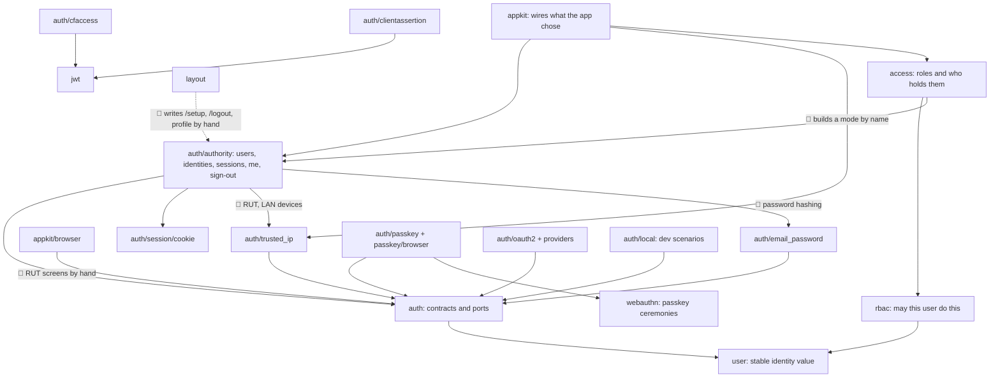

# Sign-in and permissions — signing in, who the caller is, what they may do

Map of the whole framework: [framework-map](../framework-map/SKILL.md). Last link: the code (`go doc webtyp.com/auth/authority`).

| Package | Its one job |
|---|---|
| `user` | the stable identity value every piece shares |
| `auth` | the contracts: `Authenticator` (one sign-in mode), `SessionStrategy`, the ports a mode receives (`IdentityStore`, `SessionIssuer`, `SecurityNotifier`…) |
| `auth/authority` | what every mode shares: users, identities, sessions, the crud read `me`, sign-out; mounts the modes it is given |
| `auth/session/cookie` | the session cookie strategy |
| `auth/trusted_ip`, `auth/passkey`, `auth/email_password`, `auth/oauth2`, `auth/cfaccess`, `auth/clientassertion`, `auth/local` | one sign-in mode each: its routes and, when it has one, its browser screen (`passkey/browser`) |
| `webauthn`, `jwt` | passkey ceremonies; token signing — used by modes, not by apps |
| `rbac` | whether a user may do an action on a resource; roles, grants, the implicit `RoleAuthenticated` |
| `access` | administration of roles and who holds them, with its screens (`access/ui`) |

## Rules

- **An app chooses its modes in its appkit configuration**, as values of `auth.Authenticator`; `appkit` never names a mode
  (no enum, no switch). The framework keeps the fewest, safest modes: `passkey` is the recommended mode from
  outside, `trusted_ip` for devices inside a closed network such as a clinic. No mode is implied by default.
- **`authority` knows no mode.** A mode's data (the RUT and LAN devices of `trusted_ip`, the password hash of
  `email_password`) and its first-run steps live in the mode's package.
- **A mode ships both halves**: its routes and the browser screen that calls them (**api-harness** rule 11).
- **Who the caller is reaches the layout through `view.Session`** (user and `SignOut`); the layout never names a route,
  an operation or `auth`. Flow: `auth/docs/diagrams/SIGN_IN.md`.
- «Anyone signed in may…» is a grant to `rbac.RoleAuthenticated` declared by the module that owns the resource.

## Open defects (🔴 in the diagram; each leaves when fixed)

- `authority` imports `trusted_ip` (`credentials_lan.go`, `lan_store.go`) and `email_password` (`credentials_password.go`).
- `appkit/backend/signin.go` builds `trusted_ip` and its first administrator; `appkit/browser/signin.go` draws RUT forms.
- `layout/app/browser.go` writes `/setup`, `/logout`, `Module: "authority"` and its own profile type.
- `oauth2/provider/microsoft` imports helpers from `oauth2/provider/google` instead of a shared `oauth2` helper.
- Modes no framework consumer uses: `email_password`, `cfaccess` (none); `oauth2`, `local`, `clientassertion` (only an app).
